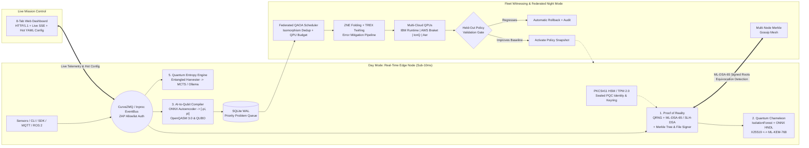

# Q-Aegis

**The Quantum-Secured Autonomous Edge-AI, Post-Quantum Security & Hybrid Quantum Optimization Platform (`v0.7.0`)**

[](https://github.com/PelleNybe/qaegis/actions/workflows/ci.yml)
[](https://pellenybe.github.io/qaegis/)
[](LICENSE)
[](pyproject.toml)
[](docs/cryptography-threat-model.md)
[](docs/manuals/operators-manual.md)
[](docs/quantum-backends.md)
[](docs/manuals/operators-manual.md)
[](pyproject.toml)

**Q-Aegis** is an open-source, production-hardened Python platform, CLI toolkit, Python SDK, and live Web Mission-Control Dashboard that unifies **NIST-standardized Post-Quantum Cryptography (`FIPS 203 / 204 / 205`)**, **hardware-sealed identity management (`PKCS#11` HSM & `TPM 2.0`)**, **AI-driven dynamic encryption**, **cryptographic provenance**, and **multi-cloud quantum optimization (`IBM Quantum`, `AWS Braket`, `IonQ`, `Qiskit Aer`, `PennyLane`)** in one cohesive package—with **zero mocks, zero stubs, and zero cloud API keys required to start**.

---

## Built for Real-World Engineering Teams

Whether you are securing ML model releases today or operating a distributed fleet of autonomous edge nodes, Q-Aegis delivers immediate standalone and integrated value:

| Audience | Immediate Problem Solved | How You Use Q-Aegis |
| :--- | :--- | :--- |
| **DevSecOps & Supply-Chain Security** | Classical RSA/ECDSA artifact signatures are vulnerable to future quantum forgery; compliance mandates cryptographic inventories. | Sign & verify ML weights, containers, firmware, and SBOMs with `ML-DSA-65` / `SLH-DSA` (`qaegis sign-file`, `verify-file`) and export **CycloneDX 1.6 CBOMs** (`qaegis cbom --format cyclonedx`). |
| **Backend & Application Developers** | Adding hybrid post-quantum encryption, key rotation, and tamper-evident audit trails typically requires stitching together low-level C bindings. | Embed `from qaegis import QAegisClient` in **6 lines of async Python**, or encrypt/decrypt secrets from scripts via `qaegis encrypt` / `qaegis decrypt`. |
| **Robotics, Drone & Critical IoT Teams** | Telemetry is exposed to **Harvest-Now-Decrypt-Later (HNDL)** interception, and edge perception inferences lack verifiable provenance. | Sign sub-10ms **Proof-of-Reality** stamps anchored in RFC 6962 Merkle trees, cross-witness roots over **CurveZMQ** gossip, and bridge **MQTT / ROS 2**. |
| **Edge-AI & ML Engineers** | Sensor vectors must be compressed deterministically on CPU-constrained edge hardware, and local LLM/MCTS planners suffer from deterministic collapse. | Compress features via self-contained **ONNX Runtime** (`0.073 ms`) into **OpenQASM 3.0** circuits, and drive **MCTS / Ollama** agents with verified quantum entropy. |
| **Quantum Computing & Operations Teams** | Cloud QPUs are too slow and noisy for real-time loops, and fleet nodes submit redundant combinatorial jobs. | Queue QUBOs in Day Mode and solve them in Night Mode via **Federated QAOA** (isomorphism deduplication + **ZNE & TREX** error mitigation + rollback guards). |

---

## Four Ways to Start in Under 60 Seconds

### 1. Install Q-Aegis (Lean CPU-Only Footprint)

```bash
git clone https://github.com/PelleNybe/qaegis.git
cd qaegis
python3 -m venv .venv
source .venv/bin/activate
pip install --no-cache-dir torch --index-url https://download.pytorch.org/whl/cpu
pip install --no-cache-dir -e .
```

### 2. Run the Zero-Config Live Pipeline (`qaegis demo`)

Execute all five subsystems live—real `liboqs` NIST FIPS 203/204/205 keys, QRNG + NIST SP 800-22/90B health tests, 3-tier Chameleon escalation (`STANDARD -> ELEVATED -> QUANTUM_CRITICAL`), ONNX-to-OpenQASM 3.0 compilation, and noisy QAOA with ZNE+TREX error mitigation:

```bash
qaegis demo          # Full showcase (~15s, zero external API keys needed)
qaegis demo --fast   # Rapid CI / smoke showcase (~8s)
```

### 3. Launch the Live Web Mission-Control Dashboard (`qaegis dashboard`)

Open a full offline-capable 8-tab browser control plane with live Server-Sent Events (SSE), host/process telemetry, interactive PQC key rotation, artifact signing, Chameleon firewall testing, OpenQASM 3.0 & PennyLane circuit visualization, Night-Mode QAOA execution, SHA-256 audit verification, and **hot-reloadable YAML configuration for every setting**:

```bash
qaegis dashboard --host 127.0.0.1 --port 8080
# Or run alongside the background daemon:
qaegis run --dashboard --dashboard-port 8080
```

### 4. Sign Files, Encrypt Secrets & Export CBOMs from the CLI

```bash
# Bootstrap a deployment profile (developer | edge | fleet | airgap)
qaegis init-config --profile developer -o qaegis.yaml

# Post-quantum detached signing & verification for models, binaries, or SBOMs
qaegis sign-file model.onnx -o model.onnx.sig.json
qaegis verify-file model.onnx model.onnx.sig.json --keyring ./keys/keyring.json

# Hybrid X25519 + ML-KEM-768 + AES-256-GCM + ML-DSA-65 file encryption
qaegis encrypt secrets.env -o secrets.env.enc.json --tier QUANTUM_CRITICAL
qaegis decrypt secrets.env.enc.json -o secrets.env.restored

# Standards-compliant CycloneDX 1.6 Cryptographic Bill of Materials
qaegis cbom --format cyclonedx --output cbom.cdx.json
```

### 5. Embed Q-Aegis in Python (`QAegisClient` SDK)

```python
import asyncio
from qaegis import QAegisClient


async def main() -> None:
    async with QAegisClient("./qaegis_state") as client:
        # 1. Sign an Edge-AI inference with QRNG entropy + ML-DSA-65 + Merkle inclusion proof
        stamp = await client.stamp("lidar-front-01", "pedestrian_crossing", confidence=0.99)
        assert client.verify_stamp(stamp).valid

        # 2. Adaptive AI firewall & hybrid ML-KEM-768 + X25519 encryption
        protected = await client.protect(b"classified-telemetry", protocol="satellite", sensitivity="secret")
        plaintext = client.decrypt(protected.envelope, use_local_keyring=True)

        # 3. Compile sensor tensor -> OpenQASM 3.0 & solve weighted Max-Cut via QAOA
        _angles, circuit, _pl = await client.compile_tensor([0.4, -0.2, 0.9, 0.1] * 4)
        solution = await client.solve_maxcut(4, [(0, 1, 1.5), (1, 2, 1.5), (2, 3, 1.5), (3, 0, 1.5)])
        print(f"Tier={protected.envelope.tier} | Depth={circuit.depth} | Cut={solution.optimal_bitstring}")


asyncio.run(main())
```

---

## Architecture & Five Unified Subsystems



| Subsystem | Package | Core Capability | Real Backing Stack |
| :--- | :--- | :--- | :--- |
| **1. Proof of Reality** | `qaegis.modules.reality_stamp` | Multi-source QRNG + NIST SP 800-22/90B validation + `ML-DSA-65` / `SLH-DSA` perception stamps & detached file signing + RFC 6962 Merkle log + P2P Merkle gossip | `liboqs`, Qiskit H-gate QRNG, `scipy`, SQLite WAL, CurveZMQ |
| **2. Quantum Chameleon** | `qaegis.modules.chameleon_fw` | Real-time AI anomaly & HNDL risk firewall dynamically escalating `X25519` ↔ Hybrid `ML-KEM-768` + `AES-256-GCM` + `ML-DSA-65` with replay defense | `scikit-learn` IsolationForest, ONNX Runtime, `liboqs`, OpenSSL |
| **3. AI-to-Qubit Compiler** | `qaegis.modules.qubit_compiler` | Neural autoencoder compressing sensor tensors into bounded $[-\pi, \pi]$ $(R_x, R_y, R_z)$ angles, validated OpenQASM 3.0 circuits, and QUBO/Ising matrices | PyTorch CPU, self-contained ONNX Runtime, Qiskit, PennyLane |
| **4. Quantum Dreaming** | `qaegis.modules.quantum_dreamer` | Day-Mode SQLite queuing + Night-Mode **Federated QAOA** across **IBM Runtime / AWS Braket / IonQ / Aer** + **ZNE & TREX** error mitigation + rollback-guarded policies | Qiskit 2.x, `amazon-braket-sdk`, IonQ v0.3, `qiskit-aer`, SciPy |
| **5. Quantum Entropy** | `qaegis.modules.quantum_entropy` | Batched entangled-circuit probability harvester XOR-mixed with QRNG driving MCTS planning, evolutionary mutation, nucleus token sampling, and Ollama / `llama.cpp` | Qiskit Aer, NIST QRNG XOR-mixer, NumPy, `httpx` |
| **Mission-Control UI & SDK** | `qaegis.dashboard` & `qaegis.sdk` | Live SSE Web Dashboard with hot-reloadable configuration (`qaegis dashboard`) and ergonomic async Python SDK (`QAegisClient`) | `h11`, Pydantic v2, `psutil`, Vanilla ES2022 SPA |

---

## Complete CLI Command Reference

| Command | Purpose |
| :--- | :--- |
| `qaegis demo [--fast]` | Run a live 5-subsystem end-to-end showcase with Rich progress & latency metrics. |
| `qaegis dashboard [--host] [--port] [--auth-token]` | Launch the 8-tab Live Web Mission-Control Dashboard & Hot-Config UI. |
| `qaegis run [--dashboard] [-c qaegis.yaml]` | Run the production Q-Aegis microkernel daemon, Prometheus exporter, and optional Web UI. |
| `qaegis init-config [--profile developer\|edge\|fleet\|airgap]` | Generate a validated `qaegis.yaml` tailored to your target environment. |
| `qaegis init-identity [-c qaegis.yaml]` | Generate NIST FIPS 203/204/205 (`ML-KEM-768`, `ML-DSA-65`, `SLH-DSA`) + `X25519` keys. |
| `qaegis rotate-keys [--seal-backend pkcs11\|tpm2]` | Execute zero-downtime PQC key rotation while preserving historical `TrustKeyring` verification. |
| `qaegis seal-identity --backend [pkcs11\|tpm2]` | Envelope-seal PQC private keys into a PKCS#11 HSM/SoftHSM2 token or Linux TPM 2.0 PCR bank. |
| `qaegis cbom [--format json\|cyclonedx] [-o cbom.json]` | Export a native or **CycloneDX 1.6** Cryptographic Bill of Materials with NIST OIDs. |
| `qaegis sign-file <file> [-o <file>.sig.json] [--stateless]` | Create a detached dual-hash (`SHA-256` + `SHA3-256`) + QRNG + PQC signature bundle for any file. |
| `qaegis verify-file <file> <sig.json> [--keyring ...]` | Verify a file offline against its detached post-quantum signature bundle and trust keyring. |
| `qaegis encrypt <in> -o <out.enc.json> [--tier ...]` | Encrypt any file with hybrid `X25519 + ML-KEM-768 + AES-256-GCM (+ ML-DSA-65)`. |
| `qaegis decrypt <in.enc.json> -o <out> [--keyring ...]` | Authenticate and decrypt an `EncryptedEnvelope` file with tamper & replay checks. |
| `qaegis stamp -s <sensor> -l <label> --confidence <p> -o stamp.json` | Harvest QRNG, run NIST SP 800-22/90B tests, sign a perception event, and anchor in Merkle WAL. |
| `qaegis verify-stamp <stamp.json> [--keyring ...]` | Offline verifier for RealityStamp payload hashes, PQC signatures, and leaf-bound Merkle proofs. |
| `qaegis compile-circuit [-v ...] [-q 4] [-o out.qasm]` | Compress a numeric feature vector into bounded qubit angles and emit OpenQASM 3.0. |
| `qaegis dream [--nodes 4] [--backend ...] [--mitigation ...]` | Solve a Max-Cut QUBO via Night-Mode QAOA across `aer_*`, `ibm_runtime`, `aws_braket`, or `ionq`. |
| `qaegis entropy [--qubits 6] [--shots 512]` | Harvest an entangled quantum probability distribution and inspect Shannon entropy. |
| `qaegis gossip [status \| verify-peer]` | Inspect witnessed fleet Merkle roots or verify peer `ML-DSA-65` checkpoints for equivocation. |
| `qaegis doctor [-c qaegis.yaml]` | Verify `liboqs` mechanisms, SQLite WAL audit/queue/policy hashes, PKCS#11 slots, and TPM 2.0. |
| `qaegis version` | Print Q-Aegis, Python, `liboqs`, Qiskit, PennyLane, and PyTorch versions. |

---

## Feature Comparison Matrix

| Capability | Traditional TLS + Edge ML | Standalone PQC Library | Cloud Quantum SDK | **Q-Aegis v0.7** |
| :--- | :---: | :---: | :---: | :---: |
| NIST FIPS 203/204/205 (`ML-KEM`, `ML-DSA`, `SLH-DSA`) + CycloneDX 1.6 CBOM | No | Partial | No | **Full Hybrid + CBOM** |
| Post-Quantum CLI File Signing & Hybrid File Encryption (`sign-file`, `encrypt`) | No | Manual C/CLI | No | **Built-In Streaming CLI & SDK** |
| Hardware Key Sealing (`PKCS#11` HSM/SoftHSM2 & Linux `TPM 2.0`) | Partial | No | No | **Yes (Envelope AEAD)** |
| Zero-Downtime PQC Key Rotation + Historical Keyring Verification | No | No | No | **Yes (`qaegis rotate-keys`)** |
| Live Web Mission-Control Dashboard + Hot-Reloadable YAML Config | No | No | Cloud-only | **Yes (`qaegis dashboard`)** |
| AI-Driven Dynamic Crypto-Agility (`STANDARD` → `CRITICAL` + Replay Defense) | No | No | No | **Yes (IsolationForest + ONNX)** |
| Multi-Node Merkle Root Gossip & Split-View Equivocation Detection | No | No | No | **Yes (ML-DSA-65 + CurveZMQ)** |
| Federated Day/Night QAOA with Isomorphism Dedup & Budget Control | No | No | No | **Yes (Multi-Vendor Registry)** |
| Native Qiskit ZNE + TREX Quantum Error Mitigation | No | No | Vendor-locked | **Yes (-85% to -97% error)** |
| Multi-Cloud QPU Backends (`IBM`, `AWS Braket`, `IonQ`, `Aer`) | No | No | Single-vendor | **Yes (Pluggable Registry)** |

---

## Reproducible Hardware Benchmarks

Measured via `.venv/bin/python benchmarks/run_benchmarks.py` ([benchmarks/results.json](benchmarks/results.json)) on a modest **4-core Intel Core i5-6200U @ 2.30 GHz (15 GB RAM, Linux x86_64, Python 3.14, `liboqs` 0.16.0, SoftHSM2, Qiskit 2.6, PyTorch CPU)**:

### Post-Quantum Primitives, Hardware Sealing & Fleet Transport

| Operation / Subsystem | Mean Latency | p95 Latency | Throughput / Wire Footprint |
| :--- | ---: | ---: | :--- |
| **ML-KEM-768** Encap + Decap (FIPS 203) | `0.076 ms` | `0.121 ms` | `13,191.3 ops/s` (PK `1,184 B` / CT `1,088 B`) |
| **ML-DSA-65** Sign / Verify (FIPS 204) | `0.213 ms` / `0.093 ms` | `0.409` / `0.161 ms` | `4,699.0` / `10,702.8 ops/s` (Sig `3,309 B`) |
| **SLH-DSA-SHA2-128f** Sign / Verify (FIPS 205) | `43.059 ms` / `2.643 ms` | `47.404` / `4.635 ms` | `23.2` / `378.4 ops/s` (Sig `17,088 B`) |
| **Chameleon `STANDARD`** (1 KB, X25519 + AES-GCM) | `0.337 ms` | `0.571 ms` | `2,969.5 ops/s` (`1,962 B` JSON) |
| **Chameleon `ELEVATED`** (1 KB, Hybrid ML-KEM-768) | `0.569 ms` | `1.012 ms` | `1,756.8 ops/s` (`3,437 B` JSON) |
| **Chameleon `QUANTUM_CRITICAL`** (Hybrid + ML-DSA-65) | `1.088 ms` | `1.942 ms` | `919.3 ops/s` (`10,462 B` JSON) |
| **RealityStamp E2E** (QRNG + ML-DSA-65 + Merkle + WAL) | `8.623 ms` | `11.884 ms` | `116.0 stamps/s` |
| **PKCS#11 SoftHSM2 Seal / Unseal** (6 KB PQC bundle) | `5.215 ms` / `5.066 ms` | `6.418` / `7.345 ms` | `191.8` / `197.4 ops/s` |
| **CurveZMQ Authenticated Event Bus** (Curve25519 ZAP) | `0.377 ms/msg` | — | **`2,655.9 msgs/s`** |
| **3-Node ML-DSA-65 Merkle Gossip Mesh** | **`21.31 ms`** | — | Full 3-node convergence |

### Edge-AI Compilation, Cached QAOA & Quantum Error Mitigation (ZNE + TREX)

| Workload | Measured Result | Quality / Speedup |
| :--- | :--- | :--- |
| **AI-to-Qubit Autoencoder** (PyTorch vs self-contained ONNX, 4q) | `0.443 ms` vs **`0.073 ms`** | **6.1x ONNX speedup** (`13,643.7 ops/s`) |
| **QAOA Weighted Max-Cut** (4q SV / 6q SV / 4q Noisy, cached circuits) | **`0.43 s` / `0.32 s` / `0.21 s`** | **11x–16x faster**, Approximation Ratio **`1.0000`** |
| **Noisy Aer Expectation — Unmitigated** (exact `-0.4831`) | `-1.5879` | Abs error `1.1048` (baseline) |
| **Noisy Aer Expectation — Combined ZNE + TREX** | **`-0.6478`** | Abs error **`0.1647`** (**`-85.1%` to `-97.6%` error reduction**) |
| **CLI Cold-Start Latency** (lazy-loaded crypto/config commands) | **`~1.0 s`** (down from `~10.0 s`) | **10x faster CLI responsiveness** |

---

## Documentation & Production Manuals

- **Documentation Home:** [docs/index.md](docs/index.md) (build locally with `mkdocs serve` or `mkdocs build --strict`)
- **Architecture & Specifications:**
  - [System Architecture & Microkernel](docs/architecture.md)
  - [Cryptography & Threat Model (FIPS 203/204/205, HSM/TPM2, Replay & Equivocation Defense)](docs/cryptography-threat-model.md)
  - [Quantum Backends, Federated QAOA & ZNE/TREX Error Mitigation](docs/quantum-backends.md)
  - [Typed Python API Reference](docs/api-reference.md)
- **Operational Manuals:**
  - [Linux (`x86_64`) & Edge ARM64 (Raspberry Pi 5) Installation Manual](docs/manuals/installation-linux-arm64.md)
  - [Production Operator's Manual (systemd, Key Rotation, Web UI, Grafana & Incident Response)](docs/manuals/operators-manual.md)
  - [Developer SDK & Plugin Guide (`QAegisClient`, Custom QPU, Hardware QRNG, HSM)](docs/manuals/developer-plugin-guide.md)
  - [Troubleshooting Guide](docs/manuals/troubleshooting.md)
- **Subsystem Deep-Dives:**
  - [Module 1: Proof of Reality (`reality_stamp`)](src/qaegis/modules/reality_stamp/README.md)
  - [Module 2: Quantum Chameleon (`chameleon_fw`)](src/qaegis/modules/chameleon_fw/README.md)
  - [Module 3: AI-to-Qubit Compiler (`qubit_compiler`)](src/qaegis/modules/qubit_compiler/README.md)
  - [Module 4: Quantum Dreaming (`quantum_dreamer`)](src/qaegis/modules/quantum_dreamer/README.md)
  - [Module 5: Quantum Entropy Engine (`quantum_entropy`)](src/qaegis/modules/quantum_entropy/README.md)

---

## Roadmap

- [x] **v0.1.0:** Core async microkernel, all five subsystems, `liboqs` FIPS 203/204/205, Qiskit/PennyLane/OpenQASM 3.0, ONNX export, MQTT & ROS 2 adapters, multi-arch Docker, systemd hardening.
- [x] **v0.2.0:** Hardware PKCS#11 (HSM/SoftHSM2) & Linux TPM 2.0 key sealing, AWS Braket & IonQ Cloud API v0.3 backend plugins, and CurveZMQ authenticated Event Bus with ZAP allowlists.
- [x] **v0.3.0:** Multi-node `ML-DSA-65` Merkle root gossiping with split-view equivocation detection, federated Night-Mode QAOA fleet scheduling with isomorphism deduplication, and native ZNE + TREX error mitigation.
- [x] **v0.4.0:** Zero-downtime PQC key rotation with historical `TrustKeyring` verification (`qaegis rotate-keys`), interactive `qaegis demo`, CycloneDX 1.6 CBOM export, Grafana v10+ & Prometheus alert packs, and >=90% coverage gate.
- [x] **v0.5.0:** Leaf-bound Merkle proof verification, Chameleon replay/cipher-suite/recipient defense, serialized SQLite WAL transactions + row integrity checks, self-contained ONNX standardization, and **11x–16x faster QAOA** via cached `ParameterVector` circuits.
- [x] **v0.6.0:** **Live Web Mission-Control Dashboard & Hot-Config Control Plane (`qaegis dashboard`)** — offline-ready 8-tab SSE web UI overseeing every subsystem, audit chain, and live YAML configuration.
- [x] **v0.7.0:** **High-Level `QAegisClient` Python SDK, Post-Quantum File Signing & Hybrid Encryption CLI (`sign-file`, `verify-file`, `encrypt`, `decrypt`, `init-config`), Web UI Artifact Signer, Clean `stderr` Telemetry, and 10x Faster CLI Startup.**

---

## Contributing & Citation

Contributions are welcome! Please review [CONTRIBUTING.md](CONTRIBUTING.md), [SECURITY.md](SECURITY.md), and [CODE_OF_CONDUCT.md](CODE_OF_CONDUCT.md).

```bibtex
@software{qaegis2026,
  title        = {Q-Aegis: Quantum-Secured Autonomous Edge-AI Platform},
  author       = {{Q-Aegis Contributors}},
  year         = {2026},
  version      = {0.7.0},
  license      = {Apache-2.0},
  url          = {https://github.com/PelleNybe/qaegis}
}
```

## License

Licensed under the [Apache License, Version 2.0](LICENSE).
