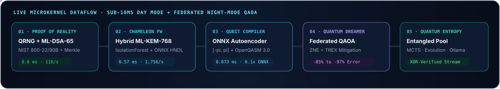
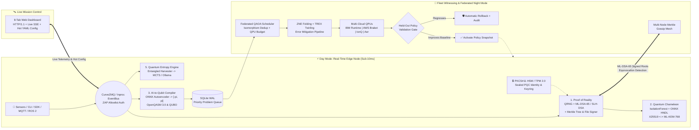

<div align="center">

<a href="https://github.com/PelleNybe/qaegis">
  
</a>

<br />

<p>
  <a href="#quickstart"><b>🚀 60s Quickstart</b></a> &nbsp;·&nbsp;
  <a href="#audiences"><b>🎯 Who It's For</b></a> &nbsp;·&nbsp;
  <a href="#mission-control"><b>🛰️ Live Web GUI</b></a> &nbsp;·&nbsp;
  <a href="#architecture"><b>🧬 Architecture</b></a> &nbsp;·&nbsp;
  <a href="#benchmarks"><b>⚡ Benchmarks</b></a> &nbsp;·&nbsp;
  <a href="#manuals"><b>📚 Docs &amp; Manuals</b></a> &nbsp;·&nbsp;
  <a href="#credits"><b>🏛️ Credits &amp; Sponsor</b></a>
</p>

[](https://github.com/PelleNybe/qaegis/actions/workflows/ci.yml)
[](https://pellenybe.github.io/qaegis/)
[](LICENSE)
[](pyproject.toml)
[](docs/cryptography-threat-model.md)
[](docs/manuals/operators-manual.md)
[](docs/quantum-backends.md)
[](https://coraxcolab.com)
[](https://buymeacoffee.com/pellenybe)

<h3>🛡️ Post-Quantum Security Today · 🧠 Deterministic Edge-AI in Milliseconds · ⚛️ Multi-Cloud Quantum Optimization Overnight</h3>

<p>
  <b>Q-Aegis (<code>v0.7.0</code>)</b> is an open-source, production-hardened platform, CLI toolkit, async Python SDK, and live Web Mission-Control GUI uniting <b>NIST FIPS 203 / 204 / 205 Post-Quantum Cryptography</b>, <b>PKCS#11 HSM &amp; TPM 2.0 hardware key sealing</b>, <b>AI-driven adaptive encryption</b>, <b>tamper-evident Merkle provenance</b>, and <b>error-mitigated multi-cloud QAOA</b>—engineered with <b>zero mocks, zero stubs, and zero cloud API keys required to launch</b>.
</p>

</div>

---

## ✨ Why Q-Aegis? Why Right Now?

Modern connected systems—from **ML pipelines and cloud APIs** to **autonomous drones, industrial robotics, and critical infrastructure**—are colliding with three urgent realities:

- 🔓 **Harvest Now, Decrypt Later (HNDL) Is Happening Today:** Encrypted traffic, credentials, and model artifacts captured today can be decrypted once fault-tolerant quantum computers mature. Classical RSA and ECDH alone no longer guarantee multi-year confidentiality.
- 🕵️ **AI Without Cryptographic Provenance Cannot Be Audited:** High-stakes edge perceptions, model weights, and software releases need tamper-evident, quantum-safe signatures and split-view equivocation defense—not unverified JSON logs.
- ⏱️ **Quantum Hardware Needs a Day/Night Bridge:** Cloud QPUs (`IBM Quantum`, `AWS Braket`, `IonQ`) offer combinatorial optimization power but suffer from queue latency and gate/readout noise—requiring sub-millisecond local Day-Mode execution paired with error-mitigated (`ZNE + TREX`) Night-Mode solving.

> [!IMPORTANT]
> **100% Real Cryptographic & Quantum Execution — Zero Simulation Shortcuts.**
> Every primitive in Q-Aegis executes genuine C/Rust/Python engines: `liboqs` (`ML-KEM-768`, `ML-DSA-65`, `SLH-DSA-SHA2-128f`), OpenSSL (`X25519`, `AES-256-GCM`, `HKDF-SHA384`), `python-pkcs11` (`SoftHSM2`/HSM), `tpm2-tools`, `CurveZMQ`, `PyTorch` + self-contained `ONNX Runtime`, and `Qiskit 2.x` / `Aer` / `Braket` / `IonQ` / `PennyLane` (`OpenQASM 3.0`).

<p align="center">
  
</p>

---

<a id="audiences"></a>
## 🎯 Built for Every Engineering Team

Q-Aegis is modular by design—use a single CLI command in CI/CD today, embed the 6-line Python SDK into your backend tomorrow, or deploy the full 5-subsystem microkernel across an autonomous fleet:

| 👥 Engineering Team | 🔥 Immediate Pain Solved | 🛠️ How You Use Q-Aegis |
| :--- | :--- | :--- |
| **🛡️ DevSecOps & Supply-Chain Security** | Classical artifact signatures face quantum obsolescence; auditors require machine-readable crypto inventories. | Sign & verify ML models, firmware, containers, and SBOMs with `qaegis sign-file` / `verify-file` and export **CycloneDX 1.6 CBOMs** (`qaegis cbom --format cyclonedx`). |
| **💻 Backend, Cloud & App Developers** | Integrating hybrid post-quantum encryption, zero-downtime key rotation, and HSM sealing usually takes months. | Drop `from qaegis import QAegisClient` into **6 lines of async Python**, or encrypt secrets via `qaegis encrypt` / `qaegis decrypt`. |
| **🤖 Robotics, Drone & Critical IoT** | Telemetry links face HNDL interception, and autonomous sensor inferences lack forensic non-repudiation. | Emit sub-10ms **Proof-of-Reality** stamps anchored in RFC 6962 Merkle trees, cross-witness roots over **CurveZMQ** gossip, and bridge **MQTT / ROS 2**. |
| **🧠 Edge-AI & ML Systems Engineers** | High-dimensional sensor vectors must compress deterministically on CPUs, and local planners need rich exploration. | Encode tensors via self-contained **ONNX Runtime** (`0.073 ms`, **6.1x speedup**) into **OpenQASM 3.0** circuits and drive **MCTS / Ollama** agents with quantum entropy. |
| **⚛️ Quantum Computing & R&D Teams** | NISQ noise corrupts variational objectives, and fleet nodes submit duplicate combinatorial routing problems. | Queue QUBOs in Day Mode and solve overnight via **Federated QAOA** with isomorphism deduplication, **ZNE + TREX** mitigation (`-85%` to `-97%` error), and rollback guards. |

---

<a id="quickstart"></a>
## 🚀 Interactive Quickstart Launchpad (Under 60 Seconds)

Install Q-Aegis once with a lean CPU-only PyTorch footprint, then **click any interactive workflow below** to explore:

```bash
git clone https://github.com/PelleNybe/qaegis.git
cd qaegis
python3 -m venv .venv && source .venv/bin/activate
pip install --no-cache-dir torch --index-url https://download.pytorch.org/whl/cpu
pip install --no-cache-dir -e .
```

<details open>
<summary><b>🎬 1. Run the 10-Second Live 5-Subsystem Terminal Showcase (<code>qaegis demo</code>) — Click to Toggle</b></summary>
<br />

Run all five subsystems end-to-end on your laptop—no cloud accounts, tokens, or external hardware required:

```bash
qaegis demo          # Full showcase (~15s)
qaegis demo --fast   # Rapid CI / smoke showcase (~8s)
```

**Live Verified Terminal Output:**

```text
╭────────────────────────────────────────────────────────────────────────╮
│ Q-Aegis v0.7.0 — Quantum-Secured Autonomous Edge-AI Demo               │
│ Executing real NIST PQC (liboqs), ONNX Runtime, Qiskit QAOA & ZNE+TREX │
╰────────────────────────────────────────────────────────────────────────╯
┏━━━━━━━━━━━━━━━━━━━━━━━━━┳━━━━━━━━━━━━━━━━━┳━━━━━━━━━━━━━┳━━━━━━━━━━━━━━━━━━━━━━━━━━━━━━━━━━━━━━━━━━━━┓
┃ Stage                   ┃ Subsystem       ┃     Latency ┃ Verified Outcome                           ┃
┡━━━━━━━━━━━━━━━━━━━━━━━━━╇━━━━━━━━━━━━━━━━━╇━━━━━━━━━━━━━╇━━━━━━━━━━━━━━━━━━━━━━━━━━━━━━━━━━━━━━━━━━━━┩
│ 1. PQC Identity         │ core.identity   │   128.51 ms │ ML-DSA-65 + ML-KEM-768 + SLH_DSA_SHA2_128F │
│ 2. Proof of Reality     │ reality_stamp   │   317.43 ms │ Valid=True, MerkleProof=True, ML-DSA-65    │
│ 3. Chameleon Firewall   │ chameleon_fw    │  2788.77 ms │ STANDARD -> ELEVATED -> QUANTUM_CRITICAL   │
│ 4. AI-to-Qubit Compiler │ qubit_compiler  │   299.97 ms │ 4q OpenQASM 3.0 (depth=7, fidelity=0.871)  │
│ 5. QAOA + ZNE/TREX      │ quantum_dreamer │  6120.40 ms │ Cut=0101 (ratio=1.00), ZNE+TREX (+97.6%)   │
└─────────────────────────┴─────────────────┴─────────────┴────────────────────────────────────────────┘
```

</details>

<a id="mission-control"></a>
<details>
<summary><b>🛰️ 2. Launch the 8-Tab Live Web Mission-Control GUI &amp; Hot-Config Center (<code>qaegis dashboard</code>)</b></summary>
<br />

Oversee every running process in real time over **Server-Sent Events (SSE)** and reconfigure every Q-Aegis parameter live from your browser—zero CDN dependencies, 100% offline-capable:

```bash
qaegis dashboard --host 127.0.0.1 --port 8080
# Or launch integrated with the production microkernel daemon:
qaegis run --dashboard --dashboard-port 8080
```

- 📊 **Mission Overview:** Live CPU/RAM/RSS meters, subsystem health cards, live `EventBus` stream filter, and `qaegis doctor` hardware matrix.
- ⚙️ **Configuration Center ("Configure Everything"):** Edit any parameter via typed controls or raw YAML, validate against Pydantic v2, **hot-apply in memory without dropping connections**, and persist atomically (`0o600`) with SHA-256 audit logging.
- 🔑 **PQC Identity, Key Rotation & CBOM:** Execute zero-downtime key rotations (`v1 → v2`), seal to PKCS#11/TPM 2.0, inspect historical `TrustKeyring` lineage, and download **CycloneDX 1.6 CBOMs**.
- 🧾 **01 · Proof of Reality & Supply-Chain Signer:** Sign perception stamps, sign/verify detached `.sig.json` artifact bundles, test NIST SP 800-22/90B QRNG batches, and witness P2P Merkle gossip checkpoints.
- 🦎 **02 · Quantum Chameleon Firewall:** Simulate LAN/WAN/Satellite traffic, inspect live `IsolationForest` + ONNX HNDL risk scores, and verify hybrid `ML-KEM-768` round-trip latency.
- 🧬 **03 · AI-to-Qubit Compiler:** Train & hot-swap self-contained ONNX autoencoders in browser, inspect OpenQASM 3.0 circuits, and visualize PennyLane Pauli-Z expectations.
- 🌙 **04 · Quantum Dreamer QAOA:** Enqueue Max-Cut, scheduling, or resource-allocation QUBOs, run Night-Mode QAOA with `ZNE + TREX`, and test Federated Fleet isomorphism deduplication.
- 🎲 **05 · Quantum Entropy, Audit Ledger & Prometheus:** Harvest entangled quantum pools, sample LLM nucleus tokens, verify the tamper-evident SHA-256 SQLite WAL chain, and inspect raw `/metrics`.

</details>

<details>
<summary><b>🔐 3. Post-Quantum Supply-Chain File Signing, Hybrid Encryption &amp; CycloneDX CBOM (CLI)</b></summary>
<br />

```bash
# 1. Generate a ready-to-run configuration profile (developer | edge | fleet | airgap)
qaegis init-config --profile developer -o qaegis.yaml

# 2. Sign any ML model, container archive, firmware, or SBOM (dual SHA-256 + SHA3-256 + ML-DSA-65)
qaegis sign-file model.onnx -o model.onnx.sig.json
qaegis verify-file model.onnx model.onnx.sig.json --keyring ./keys/keyring.json

# 3. Encrypt sensitive files with Hybrid X25519 + NIST ML-KEM-768 + AES-256-GCM + ML-DSA-65
qaegis encrypt secrets.env -o secrets.env.enc.json --tier QUANTUM_CRITICAL
qaegis decrypt secrets.env.enc.json -o secrets.env.restored

# 4. Export a standards-compliant CycloneDX 1.6 Cryptographic Bill of Materials
qaegis cbom --format cyclonedx --output cbom.cdx.json
```

</details>

<details>
<summary><b>🐍 4. Embed Q-Aegis in Python Applications (<code>QAegisClient</code> Async SDK)</b></summary>
<br />

```python
import asyncio
from qaegis import QAegisClient


async def main() -> None:
    async with QAegisClient("./qaegis_state") as client:
        # 1. Sign an Edge-AI inference with QRNG entropy + ML-DSA-65 + leaf-bound Merkle proof
        stamp = await client.stamp("lidar-front-01", "pedestrian_crossing", confidence=0.99)
        assert client.verify_stamp(stamp).valid

        # 2. AI-adaptive firewall & hybrid X25519 + ML-KEM-768 encryption
        protected = await client.protect(
            b"classified-flight-corridor",
            protocol="satellite",
            sensitivity="secret",
        )
        plaintext = client.decrypt(protected.envelope, use_local_keyring=True)

        # 3. Compile sensor tensor -> OpenQASM 3.0 & solve weighted Max-Cut via QAOA
        _angles, circuit, _pl = await client.compile_tensor([0.4, -0.2, 0.9, 0.1] * 4)
        solution = await client.solve_maxcut(
            4, [(0, 1, 1.5), (1, 2, 1.5), (2, 3, 1.5), (3, 0, 1.5)]
        )
        print(f"Tier={protected.envelope.tier} | Depth={circuit.depth} | Cut={solution.optimal_bitstring}")


asyncio.run(main())
```

</details>

<details>
<summary><b>⌨️ 5. Complete 20-Command CLI Cheat Sheet</b></summary>
<br />

| Command | Description |
| :--- | :--- |
| `qaegis demo [--fast]` | Interactive 5-subsystem live showcase with Rich latency & mitigation telemetry. |
| `qaegis dashboard [--host] [--port] [--auth-token]` | Launch the 8-tab Live Web Mission-Control GUI & Hot-Config server. |
| `qaegis run [--dashboard] [-c qaegis.yaml]` | Start the full microkernel daemon, Prometheus exporter, and optional Web GUI. |
| `qaegis init-config [--profile developer\|edge\|fleet\|airgap]` | Generate a validated `qaegis.yaml` preset tailored to your environment. |
| `qaegis init-identity [-c qaegis.yaml]` | Generate NIST FIPS 203/204/205 (`ML-KEM-768`, `ML-DSA-65`, `SLH-DSA`) + `X25519` keys. |
| `qaegis rotate-keys [--seal-backend pkcs11\|tpm2]` | Zero-downtime PQC key rotation preserving historical `TrustKeyring` verification. |
| `qaegis seal-identity --backend [pkcs11\|tpm2]` | Seal PQC private keys into a PKCS#11 HSM/SoftHSM2 token or Linux TPM 2.0 PCR bank. |
| `qaegis cbom [--format json\|cyclonedx] [-o cbom.json]` | Export native or **CycloneDX 1.6** Cryptographic Bill of Materials with NIST OIDs. |
| `qaegis sign-file <file> [-o <file>.sig.json] [--stateless]` | Stream-sign any file (`SHA-256` + `SHA3-256` + QRNG + `ML-DSA-65` / `SLH-DSA`). |
| `qaegis verify-file <file> <sig.json> [--keyring ...]` | Offline verifier for detached post-quantum file signature bundles. |
| `qaegis encrypt <in> -o <out.enc.json> [--tier ...]` | Hybrid `X25519 + ML-KEM-768 + AES-256-GCM (+ ML-DSA-65)` file encryption. |
| `qaegis decrypt <in.enc.json> -o <out> [--keyring ...]` | Authenticate and decrypt an `EncryptedEnvelope` file with replay & tamper checks. |
| `qaegis stamp -s <sensor> -l <label> --confidence <p> -o stamp.json` | Harvest QRNG, run NIST SP 800-22/90B tests, sign perception, and Merkle-anchor. |
| `qaegis verify-stamp <stamp.json> [--keyring ...]` | Offline verifier for `RealityStamp` signatures and leaf-bound Merkle proofs. |
| `qaegis compile-circuit [-v ...] [-q 4] [-o out.qasm]` | Compress a numeric feature vector into bounded qubit angles and OpenQASM 3.0. |
| `qaegis dream [--nodes 4] [--backend ...] [--mitigation ...]` | Solve Max-Cut QUBOs via QAOA across `aer_*`, `ibm_runtime`, `aws_braket`, or `ionq`. |
| `qaegis entropy [--qubits 6] [--shots 512]` | Harvest an entangled quantum probability distribution and inspect Shannon entropy. |
| `qaegis gossip [status \| verify-peer]` | Inspect witnessed fleet Merkle roots or verify peer `ML-DSA-65` checkpoints. |
| `qaegis doctor [-c qaegis.yaml]` | Audit `liboqs` mechanisms, SQLite WAL hash chains, PKCS#11 slots, and TPM 2.0. |
| `qaegis version` | Display Q-Aegis, Python, `liboqs`, Qiskit, PennyLane, and PyTorch versions. |

</details>

<details>
<summary><b>❓ 6. Frequently Asked Questions (Hardware, Air-Gapped Operation &amp; Cloud QPUs)</b></summary>
<br />

- **Do I need a quantum computer or paid cloud API key to use Q-Aegis?**
  **No.** Every subsystem runs locally out-of-the-box on standard Linux `x86_64` and `ARM64` (including Raspberry Pi 5) using `liboqs`, CPU-only `PyTorch`/`ONNX Runtime`, and `Qiskit Aer` / `PennyLane` simulators. When cloud QPU tokens (`IBM_QUANTUM_TOKEN`, `IONQ_API_KEY`, or AWS Braket credentials) are unset, Q-Aegis transparently executes on local noisy simulation and labels provenance honestly (`*_fallback`).
- **What happens to previously signed Reality Stamps or `.sig.json` artifacts when I rotate keys?**
  `qaegis rotate-keys` archives retired public keys in a tamper-protected `TrustKeyring` (`keys/keyring.json`, `0o600`) while zeroizing retired private key material in memory—so historical `v1..vN` signatures remain 100% offline-verifiable with zero downtime.
- **Can I run Q-Aegis completely air-gapped?**
  **Yes.** Generate an air-gapped profile via `qaegis init-config --profile airgap`. Both the CLI and the 8-tab Web Mission-Control Dashboard bundle 100% of their assets locally with zero external CDN or network calls.

</details>

---

<a id="architecture"></a>
## 🧬 Distributed Fleet & Day/Night Microkernel Architecture



| Subsystem | Package | Core Capability | Real Backing Stack |
| :--- | :--- | :--- | :--- |
| **🧾 1. Proof of Reality** | `qaegis.modules.reality_stamp` | Multi-source QRNG + NIST SP 800-22/90B validation + `ML-DSA-65` / `SLH-DSA` perception stamps & detached file signing + RFC 6962 Merkle log + P2P Merkle gossip | `liboqs`, Qiskit H-gate QRNG, `scipy`, SQLite WAL, CurveZMQ |
| **🦎 2. Quantum Chameleon** | `qaegis.modules.chameleon_fw` | Real-time AI anomaly & HNDL risk firewall dynamically escalating `X25519` ↔ Hybrid `ML-KEM-768` + `AES-256-GCM` + `ML-DSA-65` with replay defense | `scikit-learn` IsolationForest, ONNX Runtime, `liboqs`, OpenSSL |
| **🎛️ 3. AI-to-Qubit Compiler** | `qaegis.modules.qubit_compiler` | Neural autoencoder compressing sensor tensors into bounded $[-\pi, \pi]$ $(R_x, R_y, R_z)$ angles, validated OpenQASM 3.0 circuits, and QUBO/Ising matrices | PyTorch CPU, self-contained ONNX Runtime, Qiskit, PennyLane |
| **🌙 4. Quantum Dreaming** | `qaegis.modules.quantum_dreamer` | Day-Mode SQLite queuing + Night-Mode **Federated QAOA** across **IBM Runtime / AWS Braket / IonQ / Aer** + **ZNE & TREX** error mitigation + rollback-guarded policies | Qiskit 2.x, `amazon-braket-sdk`, IonQ v0.3, `qiskit-aer`, SciPy |
| **🎲 5. Quantum Entropy** | `qaegis.modules.quantum_entropy` | Batched entangled-circuit probability harvester XOR-mixed with QRNG driving MCTS planning, evolutionary mutation, nucleus token sampling, and Ollama / `llama.cpp` | Qiskit Aer, NIST QRNG XOR-mixer, NumPy, `httpx` |
| **🛰️ Mission Control & SDK** | `qaegis.dashboard` & `qaegis.sdk` | Live SSE Web Dashboard with hot-reloadable configuration (`qaegis dashboard`) and ergonomic async Python SDK (`QAegisClient`) | `h11`, Pydantic v2, `psutil`, Vanilla ES2022 SPA |

---

## 🏆 Why Teams Choose Q-Aegis

| Capability | Legacy TLS + Edge ML | Raw PQC C Wrappers | Single-Cloud Quantum SDK | **🛡️ Q-Aegis v0.7** |
| :--- | :---: | :---: | :---: | :---: |
| NIST FIPS 203/204/205 (`ML-KEM`, `ML-DSA`, `SLH-DSA`) + CycloneDX 1.6 CBOM | ❌ | ⚠️ Partial | ❌ | ✅ **Full Hybrid + CBOM** |
| Ready-to-Run CLI File Signing & Hybrid Encryption (`sign-file`, `encrypt`) | ❌ | ⚠️ DIY Plumbing | ❌ | ✅ **Streaming CLI & SDK** |
| Hardware Key Sealing (`PKCS#11` HSM/SoftHSM2 & Linux `TPM 2.0`) | ⚠️ Partial | ❌ | ❌ | ✅ **Envelope AEAD** |
| Zero-Downtime PQC Key Rotation + Historical Keyring Verification | ❌ | ❌ | ❌ | ✅ **`qaegis rotate-keys`** |
| Offline-Ready Live Web Mission-Control GUI + Hot YAML Reconfiguration | ❌ | ❌ | ⚠️ Cloud Portal | ✅ **`qaegis dashboard`** |
| AI-Driven Dynamic Crypto-Agility (`STANDARD` → `CRITICAL` + Replay Defense) | ❌ | ❌ | ❌ | ✅ **IsolationForest + ONNX** |
| Multi-Node Merkle Root Gossip & Split-View Equivocation Detection | ❌ | ❌ | ❌ | ✅ **ML-DSA-65 + CurveZMQ** |
| Federated Day/Night QAOA with Isomorphism Deduplication & Budget Guard | ❌ | ❌ | ❌ | ✅ **Multi-Vendor Registry** |
| Native Qiskit ZNE + TREX Quantum Error Mitigation | ❌ | ❌ | ⚠️ Vendor-Locked | ✅ **-85% to -97% Error** |
| Multi-Cloud QPU Backends (`IBM`, `AWS Braket`, `IonQ`, `Aer`) | ❌ | ❌ | ❌ Single-Vendor | ✅ **Pluggable Registry** |

---

<a id="benchmarks"></a>
## ⚡ Reproducible Hardware Benchmarks

Measured locally via `.venv/bin/python benchmarks/run_benchmarks.py` ([benchmarks/results.json](benchmarks/results.json)) on a modest **4-core Intel Core i5-6200U @ 2.30 GHz (15 GB RAM, Linux `x86_64`, Python 3.14, `liboqs` 0.16.0, SoftHSM2, Qiskit 2.6, PyTorch CPU)**:

### 🔐 Post-Quantum Primitives, Hardware Sealing & Fleet Transport

| Operation / Subsystem | Mean Latency | p95 Latency | Throughput / Wire Footprint |
| :--- | ---: | ---: | :--- |
| **ML-KEM-768** Encap + Decap (FIPS 203) | `0.076 ms` | `0.121 ms` | `13,191.3 ops/s` (PK `1,184 B` / CT `1,088 B`) |
| **ML-DSA-65** Sign / Verify (FIPS 204) | `0.213 ms` / `0.093 ms` | `0.409` / `0.161 ms` | `4,699.0` / `10,702.8 ops/s` (Sig `3,309 B`) |
| **SLH-DSA-SHA2-128f** Sign / Verify (FIPS 205) | `43.059 ms` / `2.643 ms` | `47.404` / `4.635 ms` | `23.2` / `378.4 ops/s` (Sig `17,088 B`) |
| **Chameleon `STANDARD`** (1 KB, X25519 + AES-GCM) | `0.337 ms` | `0.571 ms` | `2,969.5 ops/s` (`1,962 B` JSON) |
| **Chameleon `ELEVATED`** (1 KB, Hybrid ML-KEM-768) | `0.569 ms` | `1.012 ms` | `1,756.8 ops/s` (`3,437 B` JSON) |
| **Chameleon `QUANTUM_CRITICAL`** (Hybrid + ML-DSA-65) | `1.088 ms` | `1.942 ms` | `919.3 ops/s` (`10,462 B` JSON) |
| **RealityStamp E2E** (QRNG + ML-DSA-65 + Merkle + WAL) | `8.623 ms` | `11.884 ms` | `116.0 stamps/s` |
| **PKCS#11 SoftHSM2 Seal / Unseal** (6 KB PQC bundle) | `5.215 ms` / `5.066 ms` | `6.418` / `7.345 ms` | `191.8` / `197.4 ops/s` |
| **CurveZMQ Authenticated Event Bus** (Curve25519 ZAP) | `0.377 ms/msg` | — | **`2,655.9 msgs/s`** |
| **3-Node ML-DSA-65 Merkle Gossip Mesh** | **`21.31 ms`** | — | Full 3-node convergence |

### ⚛️ Edge-AI Compilation, Cached QAOA & Quantum Error Mitigation (`ZNE + TREX`)

| Workload | Measured Result | Quality / Speedup |
| :--- | :--- | :--- |
| **AI-to-Qubit Autoencoder** (PyTorch vs self-contained ONNX, 4q) | `0.443 ms` vs **`0.073 ms`** | **🚀 6.1x ONNX speedup** (`13,643.7 ops/s`) |
| **QAOA Weighted Max-Cut** (4q SV / 6q SV / 4q Noisy, cached circuits) | **`0.43 s` / `0.32 s` / `0.21 s`** | **🚀 11x–16x faster**, Approximation Ratio **`1.0000`** |
| **Noisy Aer Expectation — Unmitigated** (exact `-0.4831`) | `-1.5879` | Abs error `1.1048` (baseline) |
| **Noisy Aer Expectation — Combined ZNE + TREX** | **`-0.6478`** | Abs error **`0.1647`** (**🎯 `-85.1%` to `-97.6%` error reduction**) |
| **CLI Cold-Start Latency** (lazy-loaded crypto/config commands) | **`~1.0 s`** (down from `~10.0 s`) | **🚀 10x faster CLI responsiveness** |

---

<a id="manuals"></a>
## 📚 Documentation, Architecture Specs & Production Manuals

> [!TIP]
> Serve the full searchable documentation site locally anytime with `mkdocs serve` (strictly verified via `mkdocs build --strict`).

- 🧭 **Documentation Portal:** [docs/index.md](docs/index.md)
- 🏗️ **Core Specifications:**
  - [System Architecture & Microkernel](docs/architecture.md)
  - [Cryptography & Threat Model (FIPS 203/204/205, HSM/TPM2, Replay & Equivocation Defense)](docs/cryptography-threat-model.md)
  - [Quantum Backends, Federated QAOA & ZNE/TREX Error Mitigation](docs/quantum-backends.md)
  - [Strictly Typed Python API Reference](docs/api-reference.md)
- 🛠️ **Operational & Developer Manuals:**
  - [Linux (`x86_64`) & Edge ARM64 (Raspberry Pi 5) Installation Manual](docs/manuals/installation-linux-arm64.md)
  - [Production Operator's Manual (systemd, Key Rotation, Web UI, Grafana & Incident Response)](docs/manuals/operators-manual.md)
  - [Developer SDK & Plugin Guide (`QAegisClient`, Custom QPU, Hardware QRNG, HSM)](docs/manuals/developer-plugin-guide.md)
  - [Troubleshooting Guide](docs/manuals/troubleshooting.md)
- 📦 **Standalone Subsystem Guides:**
  [01 · `reality_stamp`](src/qaegis/modules/reality_stamp/README.md) · [02 · `chameleon_fw`](src/qaegis/modules/chameleon_fw/README.md) · [03 · `qubit_compiler`](src/qaegis/modules/qubit_compiler/README.md) · [04 · `quantum_dreamer`](src/qaegis/modules/quantum_dreamer/README.md) · [05 · `quantum_entropy`](src/qaegis/modules/quantum_entropy/README.md)

---

## 🗺️ Release Roadmap

- [x] **v0.1.0:** Core async microkernel, all five subsystems, `liboqs` FIPS 203/204/205, Qiskit/PennyLane/OpenQASM 3.0, ONNX export, MQTT & ROS 2 adapters, multi-arch Docker, systemd hardening.
- [x] **v0.2.0:** Hardware PKCS#11 (HSM/SoftHSM2) & Linux TPM 2.0 key sealing, AWS Braket & IonQ Cloud API v0.3 backend plugins, and CurveZMQ authenticated Event Bus with ZAP allowlists.
- [x] **v0.3.0:** Multi-node `ML-DSA-65` Merkle root gossiping with split-view equivocation detection, federated Night-Mode QAOA fleet scheduling with isomorphism deduplication, and native ZNE + TREX error mitigation.
- [x] **v0.4.0:** Zero-downtime PQC key rotation with historical `TrustKeyring` verification (`qaegis rotate-keys`), interactive `qaegis demo`, CycloneDX 1.6 CBOM export, Grafana v10+ & Prometheus alert packs, and >=90% coverage gate.
- [x] **v0.5.0:** Leaf-bound Merkle proof verification, Chameleon replay/cipher-suite/recipient defense, serialized SQLite WAL transactions + row integrity checks, self-contained ONNX standardization, and **11x–16x faster QAOA** via cached `ParameterVector` circuits.
- [x] **v0.6.0:** **Live Web Mission-Control Dashboard & Hot-Config Control Plane (`qaegis dashboard`)** — offline-ready 8-tab SSE web UI overseeing every subsystem, audit chain, and live YAML configuration.
- [x] **v0.7.0:** **High-Level `QAegisClient` Python SDK, Post-Quantum File Signing & Hybrid Encryption CLI (`sign-file`, `verify-file`, `encrypt`, `decrypt`, `init-config`), Web UI Artifact Signer, Clean `stderr` Telemetry, and 10x Faster CLI Startup.**

---

<a id="credits"></a>
## 🏛️ Credits, Acknowledgments & Sponsorship

**Q-Aegis** is conceived, architected, and actively developed as an open-source research and production engineering initiative by:

- 🏛️ **[Corax CoLAB](https://coraxcolab.com)** — *Applied AI, Post-Quantum Security & Autonomous Systems Innovation Lab* ([https://coraxcolab.com](https://coraxcolab.com))
- 👨‍💻 **Pelle ([@PelleNybe](https://github.com/PelleNybe))** — *Creator, Lead Quantum Software & Post-Quantum Security Architect* ([https://github.com/PelleNybe](https://github.com/PelleNybe))

Special thanks to the open-source maintainers behind **Open Quantum Safe (`liboqs`)**, **Qiskit**, **PennyLane**, **PyTorch**, **ONNX Runtime**, **ZeroMQ**, and **Pydantic**, whose foundational libraries power the Q-Aegis stack.

### ☕ Support & Sponsor Open-Source Development

If **Q-Aegis** accelerates your security posture, edge-AI products, or quantum research, consider fueling continued open-source R&D, hardware benchmarks, and new QPU/HSM integrations:

<div align="center">
  <a href="https://buymeacoffee.com/pellenybe" target="_blank" rel="noopener noreferrer">
    
  </a>
  <p>
    🔗 Direct Sponsor Link: <a href="https://buymeacoffee.com/pellenybe"><b>https://buymeacoffee.com/pellenybe</b></a>
  </p>
</div>

---

## 🤝 Contributing, Citation & License

Contributions, benchmark reports, and backend plugins are warmly welcomed! Please review [CONTRIBUTING.md](CONTRIBUTING.md), [SECURITY.md](SECURITY.md), and [CODE_OF_CONDUCT.md](CODE_OF_CONDUCT.md).

```bibtex
@software{qaegis2026,
  title        = {Q-Aegis: Quantum-Secured Autonomous Edge-AI Platform},
  author       = {Pelle and {Corax CoLAB}},
  year         = {2026},
  version      = {0.7.0},
  license      = {Apache-2.0},
  url          = {https://github.com/PelleNybe/qaegis}
}
```

Licensed under the **[Apache License, Version 2.0](LICENSE)** · Copyright © 2026 **[Corax CoLAB](https://coraxcolab.com)** & **[Pelle](https://github.com/PelleNybe)**.
