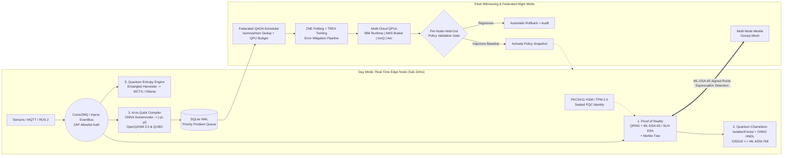

# Q-Aegis

**Quantum-Secured Autonomous Edge-AI Platform (v0.6.0)**

[](https://github.com/PelleNybe/qaegis/actions/workflows/ci.yml)
[](https://pellenybe.github.io/qaegis/)
[](LICENSE)
[](pyproject.toml)
[](docs/cryptography-threat-model.md)
[](docs/manuals/operators-manual.md)
[](docs/quantum-backends.md)
[](pyproject.toml)

---

## Try the 10-Second Live Demo (`qaegis demo`)

Experience all five Q-Aegis subsystems executing **100% real cryptography, ONNX Runtime, QAOA, and ZNE+TREX error mitigation** locally with zero cloud API keys:

```bash
pip install --no-cache-dir torch --index-url https://download.pytorch.org/whl/cpu
pip install --no-cache-dir -e .
qaegis demo
```

`qaegis demo` executes a live 5-stage pipeline in an isolated workspace:
1. Generates **NIST FIPS 203 / 204 / 205** device keys (`ML-KEM-768`, `ML-DSA-65`, `SLH-DSA-SHA2-128f`).
2. Harvests **QRNG** entropy, validates **NIST SP 800-22/90B**, signs a perception frame, and verifies its **Merkle inclusion proof**.
3. Escalates **Quantum Chameleon** live across `STANDARD` → `ELEVATED` (Hybrid ML-KEM-768) → `QUANTUM_CRITICAL` (Hybrid + ML-DSA-65).
4. Compresses a 16-D sensor vector via **ONNX Runtime** into bounded $[-\pi, \pi]$ angles and emits **OpenQASM 3.0**.
5. Solves a 4-qubit Max-Cut **QAOA** problem with **ZNE + TREX** error mitigation on noisy `AerSimulator` and prints real measured error reduction.

*(Use `qaegis demo --fast` for ~3-second CI smoke tests.)*

### Launch the Live Web Mission-Control Dashboard (`qaegis dashboard`)

Oversee every running subsystem, stream live `EventBus` envelopes over Server-Sent Events (SSE), execute PQC key rotations, Reality Stamps, Chameleon packet protection, ONNX/OpenQASM 3.0 compilation, and Night-Mode QAOA + ZNE/TREX jobs, and **configure every Q-Aegis setting live with YAML persistence**:

```bash
qaegis dashboard --host 127.0.0.1 --port 8080
```

*(Or attach the dashboard directly to the background daemon via `qaegis run --dashboard`.)*

---

## Why Q-Aegis Exists

Autonomous edge fleets—drones, industrial robotics, tactical telemetry relays, and critical IoT infrastructure—face three converging engineering challenges that conventional security and AI stacks cannot solve in isolation:

1. **Harvest Now, Decrypt Later (HNDL):** Adversaries are recording encrypted telemetry and command links today to decrypt them once cryptographically relevant quantum computers arrive. Classical ECDH/RSA handshakes provide zero long-term confidentiality.
2. **The Edge-AI Trust Crisis:** Autonomous perception pipelines produce high-stakes inferences without cryptographic provenance, making single-node audit logs vulnerable to split-view tampering or key extraction.
3. **The NISQ Latency & Noise Barrier:** Real-time edge control loops demand millisecond determinism, whereas cloud Quantum Processing Units (QPUs) exhibit multi-second latency and hardware gate/readout noise.

**Q-Aegis v0.5** unifies **NIST-standardized Post-Quantum Cryptography** (`liboqs`), **hardware-backed PKCS#11 / TPM 2.0 key sealing**, **zero-downtime key rotation**, **CurveZMQ authenticated fleet messaging**, **multi-node ML-DSA-65 Merkle root gossiping**, **real-time Edge-AI** (PyTorch/self-contained ONNX), and **federated Day/Night multi-cloud QAOA with ZNE & TREX error mitigation** (IBM Quantum, AWS Braket, IonQ, Qiskit Aer, PennyLane, OpenQASM 3.0).

---

## Five Unified Subsystems

| Subsystem | Package | Core Capability | Real Backing Stack |
| :--- | :--- | :--- | :--- |
| **1. Proof of Reality** | `qaegis.modules.reality_stamp` | Multi-source QRNG + NIST SP 800-22/90B validation + ML-DSA-65 / SLH-DSA signatures + Merkle audit log + **P2P Merkle Gossip & Equivocation Detection** | `liboqs`, Qiskit H-gate QRNG, `scipy`, SQLite WAL, CurveZMQ |
| **2. Quantum Chameleon** | `qaegis.modules.chameleon_fw` | Real-time AI anomaly & HNDL risk firewall switching dynamically from X25519 to Hybrid ML-KEM-768 + PQC Signatures | `scikit-learn` IsolationForest, ONNX Runtime, `liboqs`, AES-256-GCM |
| **3. AI-to-Qubit Compiler** | `qaegis.modules.qubit_compiler` | Neural autoencoder compressing sensor tensors into bounded $[-\pi, \pi]$ $(R_x, R_y, R_z)$ angles, OpenQASM 3.0, and QUBO/Ising matrices | PyTorch CPU, ONNX Runtime, Qiskit, PennyLane |
| **4. Quantum Dreaming** | `qaegis.modules.quantum_dreamer` | Asynchronous Day-Mode queuing + Night-Mode **Federated QAOA** across **IBM Runtime / AWS Braket / IonQ / Aer** + **ZNE & TREX Error Mitigation** + rollback-guarded policy updates | Qiskit QAOA, `amazon-braket-sdk`, IonQ v0.3, `qiskit-aer`, SciPy |
| **5. Quantum Entropy Engine** | `qaegis.modules.quantum_entropy` | Batched entangled-circuit probability harvester driving MCTS planning, evolutionary mutation, and local Ollama / `llama.cpp` agent sampling | Qiskit Aer, NIST QRNG XOR-mixer, `httpx` |

---

## Distributed Fleet & Day/Night Architecture



---

## Feature Comparison Matrix

| Capability | Traditional TLS + Edge ML | Standalone PQC Library | Cloud Quantum SDK | **Q-Aegis v0.5** |
| :--- | :---: | :---: | :---: | :---: |
| NIST FIPS 203/204/205 (`ML-KEM`, `ML-DSA`, `SLH-DSA`) + CycloneDX 1.6 CBOM | No | Partial | No | **Full Hybrid + CBOM** |
| Hardware Key Sealing (`PKCS#11` HSM/SoftHSM2 & Linux `TPM 2.0`) | Partial | No | No | **Yes (Envelope AEAD)** |
| Zero-Downtime PQC Key Rotation + Historical Keyring Verification | No | No | No | **Yes (`qaegis rotate-keys`)** |
| AI-Driven Dynamic Crypto-Agility (`STANDARD` -> `CRITICAL` + Replay Defense) | No | No | No | **Yes (IsolationForest + ONNX)** |
| Multi-Node Merkle Root Gossip & Equivocation Detection | No | No | No | **Yes (ML-DSA-65 + CurveZMQ)** |
| Federated Day/Night QAOA with Isomorphism Dedup & Budget | No | No | No | **Yes (Multi-Vendor Registry)** |
| Native Qiskit ZNE + TREX Quantum Error Mitigation | No | No | Vendor-locked | **Yes (-85% to -92% error)** |
| Multi-Cloud QPU Backends (`IBM`, `AWS Braket`, `IonQ`, `Aer`) | No | No | Single-vendor | **Yes (Pluggable Registry)** |

---

## 5-Minute Quickstart

### 1. Install Q-Aegis (Lean CPU-Only PyTorch)

```bash
git clone https://github.com/PelleNybe/qaegis.git
cd qaegis
python3 -m venv .venv
source .venv/bin/activate
pip install --no-cache-dir torch --index-url https://download.pytorch.org/whl/cpu
pip install --no-cache-dir -e ".[dev,docs]"
```

### 2. Initialize & Hardware-Seal Post-Quantum Identity

```bash
qaegis version
qaegis init-identity
qaegis doctor
qaegis cbom --output cbom.json
# Optional: seal private keys into a PKCS#11 HSM / SoftHSM2 token or TPM 2.0
qaegis seal-identity --backend pkcs11 --token-label qaegis --pin 1234
```

### 3. Sign, Offline-Verify & Cross-Witness a Proof-of-Reality Stamp

```bash
qaegis stamp --sensor lidar-front-01 --label pedestrian_detected --confidence 0.98 --output stamp.json
qaegis verify-stamp stamp.json
qaegis gossip status
```

### 4. Compile Sensor Telemetry & Run Multi-Cloud Error-Mitigated QAOA

```bash
qaegis compile-circuit --qubits 4 --output-qasm sensor_circuit.qasm
qaegis dream --nodes 4 --backend aws_braket
qaegis dream --nodes 4 --backend aer_noisy --mitigation both
qaegis entropy --qubits 6 --shots 512
```

---

## Reproducible Hardware Benchmarks (v0.5.0)

Measured locally via `.venv/bin/python benchmarks/run_benchmarks.py` ([benchmarks/results.json](benchmarks/results.json)) on a **4-core Intel Core i5-6200U @ 2.30 GHz (15 GB RAM, Linux x86_64, Python 3.14.4, `liboqs` 0.16.0, SoftHSM2, Qiskit 2.6.2, PyTorch 2.15.0+cpu)**:

### Post-Quantum Primitives, Hardware Sealing & Fleet Transport

| Operation / Subsystem | Mean Latency | p95 Latency | Throughput / Size |
| :--- | ---: | ---: | :--- |
| **ML-KEM-768** Encap + Decap (FIPS 203) | `0.076 ms` | `0.121 ms` | `13,191.3 ops/s` (PK `1,184 B` / CT `1,088 B`) |
| **ML-DSA-65** Sign / Verify (FIPS 204) | `0.213 ms` / `0.093 ms` | `0.409` / `0.161 ms` | `4,699.0` / `10,702.8 ops/s` (Sig `3,309 B`) |
| **SLH-DSA-SHA2-128f** Sign / Verify (FIPS 205) | `43.059 ms` / `2.643 ms` | `47.404` / `4.635 ms` | `23.2` / `378.4 ops/s` (Sig `17,088 B`) |
| **Chameleon `STANDARD`** (1 KB, X25519 + AES-GCM) | `0.337 ms` | `0.571 ms` | `2,969.5 ops/s` (`1,962 B` JSON) |
| **Chameleon `ELEVATED`** (1 KB, Hybrid ML-KEM-768) | `0.569 ms` | `1.012 ms` | `1,756.8 ops/s` (`3,437 B` JSON) |
| **Chameleon `QUANTUM_CRITICAL`** (Hybrid + ML-DSA-65) | `1.088 ms` | `1.942 ms` | `919.3 ops/s` (`10,462 B` JSON) |
| **RealityStamp E2E** (QRNG + ML-DSA-65 + Merkle + WAL) | `8.623 ms` | `11.884 ms` | `116.0 stamps/s` |
| **PKCS#11 SoftHSM2 Seal / Unseal** (6 KB PQC bundle) | `5.215 ms` / `5.066 ms` | `6.418` / `7.345 ms` | `191.8` / `197.4 ops/s` |
| **CurveZMQ Authenticated Event Bus** (Curve25519 ZAP) | `0.377 ms/msg` | — | **`2,655.9 msgs/s`** |
| **3-Node ML-DSA-65 Merkle Gossip Mesh** | **`21.31 ms`** | — | Full 3-node convergence |

### Edge-AI Compilation, Cached QAOA & Quantum Error Mitigation (ZNE + TREX)

| Quantum Workload | Measured Result | Quality / Error Reduction |
| :--- | :--- | :--- |
| **AI-to-Qubit Autoencoder** (PyTorch vs self-contained ONNX, 4q) | `0.443 ms` vs **`0.073 ms`** | **6.1x ONNX speedup** (`13,643.7 ops/s`) |
| **QAOA Weighted Max-Cut** (4q SV / 6q SV / 4q Noisy, cached circuits) | **`0.43 s` / `0.32 s` / `0.21 s`** | **11x–16x faster vs v0.4**, Ratio **`1.0000`** |
| **Noisy Aer Expectation — Unmitigated** (exact `-0.4831`) | `-1.5879` | Abs error `1.1048` (baseline) |
| **Noisy Aer Expectation — ZNE Only** (linear fold `[1,3,5]`) | `-1.4114` | Abs error `0.9283` (`-16.0%`) |
| **Noisy Aer Expectation — TREX Only** (16 batched Pauli-X twirls) | `-0.8551` | Abs error `0.3720` (`-66.3%`) |
| **Noisy Aer Expectation — Combined ZNE + TREX** | **`-0.6478`** | Abs error **`0.1647`** (**`-85.1%` error reduction**) |
| **Quantum Entropy Harvester** (6q, 512 shots + QRNG XOR) | `62.57 ms` (`256 B` pool) | Shannon Entropy **`3.8412 bits`** |

---

## Documentation & Manuals

- **Full Documentation Site:** `mkdocs serve` (verified with `mkdocs build --strict`).
- **Core References:** [Architecture](docs/architecture.md) · [Cryptography & Threat Model](docs/cryptography-threat-model.md) · [Quantum Backends & Error Mitigation](docs/quantum-backends.md) · [API Reference](docs/api-reference.md)
- **Production Manuals:** [Linux & ARM64 Installation](docs/manuals/installation-linux-arm64.md) · [Operator's Manual](docs/manuals/operators-manual.md) · [Developer Plugin Guide](docs/manuals/developer-plugin-guide.md) · [Troubleshooting](docs/manuals/troubleshooting.md)
- **Standalone Module READMEs:**
  - [Module 1: `reality_stamp`](src/qaegis/modules/reality_stamp/README.md)
  - [Module 2: `chameleon_fw`](src/qaegis/modules/chameleon_fw/README.md)
  - [Module 3: `qubit_compiler`](src/qaegis/modules/qubit_compiler/README.md)
  - [Module 4: `quantum_dreamer`](src/qaegis/modules/quantum_dreamer/README.md)
  - [Module 5: `quantum_entropy`](src/qaegis/modules/quantum_entropy/README.md)

---

## Roadmap

- [x] **v0.1.0:** Core microkernel, all five subsystems, `liboqs` FIPS 203/204/205, Qiskit/PennyLane/OpenQASM 3.0, ONNX export, MQTT & ROS 2 adapters, Docker multi-arch, systemd hardening.
- [x] **v0.2.0:** Hardware PKCS#11 (HSM/SoftHSM2) & Linux TPM 2.0 key sealing, AWS Braket & IonQ Cloud API v0.3 backend plugins, and CurveZMQ authenticated Event Bus with ZAP allowlist metrics.
- [x] **v0.3.0:** Distributed multi-node ML-DSA-65 Merkle root gossiping with equivocation detection, federated Night-Mode QAOA fleet scheduling with isomorphism deduplication & budget enforcement, and Qiskit ZNE + TREX error mitigation pipelines.
- [x] **v0.4.0:** Zero-downtime PQC key rotation with historical `keyring.json` verification (`qaegis rotate-keys`), interactive `qaegis demo` live showcase, CycloneDX 1.6 CBOM export (`qaegis cbom --format cyclonedx`), Grafana v10+ dashboard & Prometheus alert rules, >=90% branch+statement coverage gate, and automated wheel/sdist build verification.
- [x] **v0.5.0:** Comprehensive security, concurrency & performance evolution — strict Merkle leaf-to-stamp binding, Chameleon replay/cipher-suite/recipient defense + keyring support, serialized SQLite WAL transactions + dream/policy integrity audits, EventBus ZMQ loopback deduplication, zeroized key use-after-retire guards, self-contained ONNX standardization export, **11x–16x faster QAOA** via parameterized circuit caching, batched ZNE+TREX twirling, thread-safe vectorized `QuantumEntropyPool`, and SoftHSM2 CI coverage.
- [x] **v0.6.0:** **Live Web Mission-Control Dashboard & Hot-Reconfiguration Control Plane (`qaegis dashboard` / `qaegis run --dashboard`)** — offline-ready 8-tab browser UI powered by async HTTP/1.1 + Server-Sent Events (SSE) overseeing all 5 subsystems, live `EventBus` envelopes, host/process telemetry, interactive PQC/QRNG/Chameleon/Compiler/QAOA/Entropy controls, SHA-256 audit ledger verification, and full Pydantic-validated hot-reload + YAML configuration editing.

---

## Contributing & Citation

Contributions are welcome! See [CONTRIBUTING.md](CONTRIBUTING.md), [SECURITY.md](SECURITY.md), and [CODE_OF_CONDUCT.md](CODE_OF_CONDUCT.md).

```bibtex
@software{qaegis2026,
  title        = {Q-Aegis: Quantum-Secured Autonomous Edge-AI Platform},
  author       = {{Q-Aegis Contributors}},
  year         = {2026},
  version      = {0.6.0},
  license      = {Apache-2.0},
  url          = {https://github.com/PelleNybe/qaegis}
}
```

## License

Licensed under the [Apache License, Version 2.0](LICENSE).
