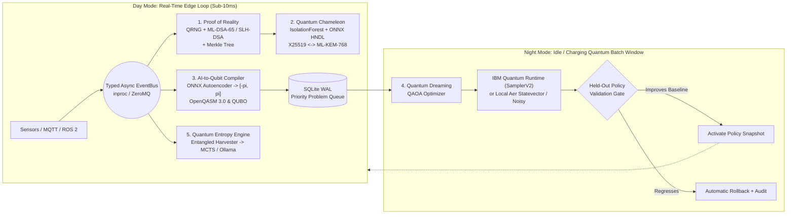

# Q-Aegis

**Quantum-Secured Autonomous Edge-AI Platform**

[](https://github.com/PelleNybe/qaegis/actions/workflows/ci.yml)
[](LICENSE)
[](pyproject.toml)
[](docs/cryptography-threat-model.md)
[](docs/quantum-backends.md)
[](pyproject.toml)

---

## Why Q-Aegis Exists

Autonomous edge systems—drones, industrial robotics, tactical telemetry relays, and critical IoT infrastructure—face three converging engineering challenges that conventional security and AI stacks cannot solve in isolation:

1. **Harvest Now, Decrypt Later (HNDL):** Adversaries are recording encrypted telemetry and command links today to decrypt them once cryptographically relevant quantum computers arrive. Classical ECDH/RSA handshakes provide zero long-term confidentiality.
2. **The Edge-AI Trust Crisis:** Autonomous perception pipelines produce high-stakes inferences without cryptographic provenance. Spoofed sensor frames, replayed telemetry, or tampered audit logs undermine safety certification and forensic accountability.
3. **The NISQ Latency Barrier:** Real-time edge control loops require millisecond determinism, whereas cloud Quantum Processing Units (QPUs) exhibit multi-second queue and execution latency. Calling a QPU in a hot control path is architecturally impossible.

**Q-Aegis** resolves all three challenges inside a single, modular, Apache-2.0 Python 3.11+ microkernel that unifies **NIST-standardized Post-Quantum Cryptography** (`liboqs`), **real-time Edge-AI** (PyTorch/ONNX), and **asynchronous Day/Night hybrid quantum computing** (Qiskit, PennyLane, OpenQASM 3.0).

---

## Five Unified Subsystems

| Subsystem | Package | Core Capability | Real Backing Stack |
| :--- | :--- | :--- | :--- |
| **1. Proof of Reality** | `qaegis.modules.reality_stamp` | Multi-source QRNG + NIST SP 800-22/90B validation + ML-DSA-65 / SLH-DSA signatures + Merkle audit log | `liboqs`, Qiskit H-gate QRNG, `scipy`, SQLite WAL |
| **2. Quantum Chameleon** | `qaegis.modules.chameleon_fw` | Real-time AI anomaly & HNDL risk firewall switching dynamically from X25519 to Hybrid ML-KEM-768 + PQC Signatures | `scikit-learn` IsolationForest, ONNX Runtime, `liboqs`, AES-256-GCM |
| **3. AI-to-Qubit Compiler** | `qaegis.modules.qubit_compiler` | Neural autoencoder compressing sensor tensors into bounded $[-\pi, \pi]$ $(R_x, R_y, R_z)$ angles, OpenQASM 3.0, and QUBO/Ising matrices | PyTorch CPU, ONNX Runtime, Qiskit, PennyLane |
| **4. Quantum Dreaming** | `qaegis.modules.quantum_dreamer` | Asynchronous Day-Mode queuing + Night-Mode QAOA optimization on IBM Quantum Runtime or Aer simulators with rollback-guarded policy updates | Qiskit QAOA, `qiskit-aer`, `qiskit-ibm-runtime`, SciPy COBYLA |
| **5. Quantum Entropy Engine** | `qaegis.modules.quantum_entropy` | Batched entangled-circuit probability harvester driving MCTS planning, evolutionary mutation, and local Ollama / `llama.cpp` agent sampling | Qiskit Aer, NIST QRNG XOR-mixer, `httpx` |

---

## System Architecture & Day/Night Lifecycle



---

## Feature Comparison Matrix

| Capability | Traditional TLS + Edge ML | Standalone PQC Library | Cloud Quantum SDK | **Q-Aegis Platform** |
| :--- | :---: | :---: | :---: | :---: |
| NIST FIPS 203/204/205 (`ML-KEM`, `ML-DSA`, `SLH-DSA`) | No | Partial | No | **Full Hybrid + CBOM** |
| AI-Driven Dynamic Crypto-Agility (`STANDARD` -> `CRITICAL`) | No | No | No | **Yes (IsolationForest + ONNX)** |
| Quantum-Seeded Perception Provenance + Merkle Proofs | No | No | No | **Yes (NIST SP 800-22/90B)** |
| Day/Night Decoupling of Edge Latency & QPU Queues | No | No | No | **Yes (State Machine + Rollback)** |
| Neural Sensor-to-Qubit Angle Compression (ONNX -> OpenQASM 3) | No | No | No | **Yes (Qiskit + PennyLane)** |
| Quantum-Entropy MCTS & Local Ollama / `llama.cpp` Bridge | No | No | No | **Yes** |
| Runs Offline on `linux/amd64` & `linux/arm64` (CPU-only) | Yes | Yes | Cloud-only | **Yes (Zero Mock Fallbacks)** |

---

## 5-Minute Quickstart

### Prerequisites
- Linux (`x86_64` or `arm64`, e.g., Ubuntu 22.04/24.04 or Raspberry Pi 5 OS)
- Python 3.11+
- `liboqs` shared library installed (see [Linux & ARM64 Installation Manual](docs/manuals/installation-linux-arm64.md))

### 1. Install Q-Aegis (Lean CPU-Only PyTorch)

```bash
git clone https://github.com/PelleNybe/qaegis.git
cd qaegis
python3 -m venv .venv
source .venv/bin/activate
pip install --no-cache-dir torch --index-url https://download.pytorch.org/whl/cpu
pip install --no-cache-dir -e ".[dev,docs]"
```

### 2. Initialize Post-Quantum Identity & Verify System Health

```bash
qaegis version
qaegis init-identity
qaegis doctor
qaegis cbom --output cbom.json
```

### 3. Sign & Offline-Verify a Proof-of-Reality Stamp

```bash
qaegis stamp \
  --sensor lidar-front-01 \
  --label pedestrian_detected \
  --confidence 0.98 \
  --output stamp.json

qaegis verify-stamp stamp.json
```

### 4. Compile Sensor Telemetry to OpenQASM 3.0 & Run a Night-Mode Quantum Dream

```bash
qaegis compile-circuit --qubits 4 --output-qasm sensor_circuit.qasm
qaegis dream --nodes 4 --backend aer_statevector
qaegis entropy --qubits 6 --shots 512
```

### 5. Run the Full Microkernel Daemon

```bash
qaegis run --config deploy/config/qaegis.example.yaml
```

---

## Reproducible Hardware Benchmarks

All metrics below were measured locally by running `.venv/bin/python benchmarks/run_benchmarks.py` ([benchmarks/results.json](benchmarks/results.json)) on a **4-core Intel Core i5-6200U @ 2.30 GHz (15 GB RAM, Linux x86_64, Python 3.14.4, `liboqs` 0.16.0, Qiskit 2.6.2, PyTorch 2.15.0+cpu)**:

### Post-Quantum Cryptographic Primitives & Adaptive Firewall

| Operation / Cipher Suite | Mean Latency | p95 Latency | Throughput | Key / Wire Size |
| :--- | ---: | ---: | ---: | :--- |
| **ML-KEM-768** Encap + Decap (FIPS 203) | `0.071 ms` | `0.108 ms` | `14,109.9 ops/s` | PK `1,184 B` / CT `1,088 B` |
| **ML-DSA-65** Sign (FIPS 204) | `0.218 ms` | `0.459 ms` | `4,587.3 ops/s` | PK `1,952 B` / Sig `3,309 B` |
| **ML-DSA-65** Verify (FIPS 204) | `0.098 ms` | `0.184 ms` | `10,217.4 ops/s` | — |
| **SLH-DSA-SHA2-128f** Sign (FIPS 205) | `41.985 ms` | `46.145 ms` | `23.8 ops/s` | PK `32 B` / Sig `17,088 B` |
| **SLH-DSA-SHA2-128f** Verify (FIPS 205) | `2.580 ms` | `3.142 ms` | `387.6 ops/s` | — |
| **Chameleon `STANDARD`** (1 KB, X25519 + AES-256-GCM) | `0.282 ms` | `0.326 ms` | `3,539.9 ops/s` | `1,960 B` JSON envelope |
| **Chameleon `ELEVATED`** (1 KB, Hybrid ML-KEM-768) | `0.512 ms` | `0.939 ms` | `1,951.8 ops/s` | `3,435 B` JSON envelope |
| **Chameleon `QUANTUM_CRITICAL`** (1 KB, Hybrid + ML-DSA-65) | `1.079 ms` | `1.726 ms` | `927.1 ops/s` | `10,460 B` JSON envelope |
| **RealityStamp E2E** (QRNG + ML-DSA-65 + Merkle + SQLite) | `5.313 ms` | `9.200 ms` | `188.2 ops/s` | Persistent WAL leaf |

### Edge-AI Compilation, QAOA Night-Mode Convergence & Quantum Entropy

| Subsystem Workload | Mean Time | Throughput / Output | Quality Metric |
| :--- | ---: | :--- | :--- |
| **AI-to-Qubit Autoencoder (PyTorch CPU, 16D -> 4q)** | `0.430 ms` | `2,323.7 ops/s` | Angles strictly in $[-\pi, \pi]$ |
| **AI-to-Qubit Autoencoder (ONNX Runtime CPU, 16D -> 4q)** | `0.081 ms` | `12,306.1 ops/s` (**5.3x faster**) | Max error $< 10^{-4}$ rad |
| **Qiskit Noise-Aware Transpile + OpenQASM 3.0 (4q)** | `77.006 ms` | `13.0 ops/s` | Validated QASM3 roundtrip |
| **QAOA 4-Qubit Weighted Max-Cut (`AerStatevector`)** | `5,710.42 ms` | Optimal Energy `-6.0` (exact `-6.0`) | **Approximation Ratio `1.0000`** |
| **QAOA 6-Qubit Weighted Max-Cut (`AerStatevector`)** | `6,189.19 ms` | Optimal Energy `-8.5` (exact `-8.5`) | **Approximation Ratio `1.0000`** |
| **QAOA 4-Qubit Weighted Max-Cut (`AerNoisy`)** | `1,360.82 ms` | Optimal Energy `-6.0` (exact `-6.0`) | **Approximation Ratio `1.0000`** |
| **Quantum Entropy Harvest (6q, 512 shots + QRNG XOR)** | `65.29 ms` | `256 B` verified pool | Shannon Entropy **`3.8212 bits`** |

---

## Documentation & Module Guides

- **Full Documentation Site:** Build locally with `mkdocs serve` (strictly validated with `mkdocs build --strict`).
- **Architecture & Threat Model:** [Architecture](docs/architecture.md) · [Cryptography & Threat Model](docs/cryptography-threat-model.md) · [Quantum Backends](docs/quantum-backends.md)
- **Production Manuals:** [Linux & ARM64 Installation](docs/manuals/installation-linux-arm64.md) · [Operator's Manual](docs/manuals/operators-manual.md) · [Developer Plugin Guide](docs/manuals/developer-plugin-guide.md) · [Troubleshooting](docs/manuals/troubleshooting.md)
- **Standalone Module READMEs:**
  - [Module 1: `reality_stamp`](src/qaegis/modules/reality_stamp/README.md)
  - [Module 2: `chameleon_fw`](src/qaegis/modules/chameleon_fw/README.md)
  - [Module 3: `qubit_compiler`](src/qaegis/modules/qubit_compiler/README.md)
  - [Module 4: `quantum_dreamer`](src/qaegis/modules/quantum_dreamer/README.md)
  - [Module 5: `quantum_entropy`](src/qaegis/modules/quantum_entropy/README.md)

---

## Security Guarantees

- **Strict Key Isolation:** Secret keys are written atomically with `0o600` permissions inside `0o700` directories; startup refuses to load world- or group-readable key material.
- **Constant-Time Verification:** Key fingerprints, hashes, and shared secrets are compared using `hmac.compare_digest`.
- **Tamper-Evident Persistence:** Every Reality Stamp is anchored in an RFC 6962 domain-separated SHA-256 Merkle tree; all microkernel actions are chained in a SHA-256 SQLite WAL audit log verified by `qaegis doctor`.
- **Automated CBOM:** Run `qaegis cbom` to export a machine-readable Cryptographic Bill of Materials detailing every active NIST FIPS 203/204/205 and classical primitive.

Please review [SECURITY.md](SECURITY.md) for our threat model and responsible disclosure policy.

---

## Roadmap

- **v0.1 (Current):** Core microkernel, all five subsystems, `liboqs` FIPS 203/204/205, Qiskit/PennyLane/OpenQASM 3.0, ONNX export, MQTT & ROS 2 adapters, Docker multi-arch, systemd hardening.
- **v0.2:** Hardware TPM 2.0 / PKCS#11 sealing for PQC identity keys, AWS Braket & IonQ backend plugins, ZeroMQ CurveZMQ authenticated bus encryption.
- **v0.3:** Distributed multi-node Merkle root gossiping, federated Night-Mode QAOA fleet scheduling, and Qiskit Error Mitigation (ZNE/TREX) pipelines.

---

## Contributing & Citation

Contributions are welcome! Please read [CONTRIBUTING.md](CONTRIBUTING.md) and our [Code of Conduct](CODE_OF_CONDUCT.md).

If you use Q-Aegis in academic research or industrial systems, please cite it using [CITATION.cff](CITATION.cff):

```bibtex
@software{qaegis2026,
  title        = {Q-Aegis: Quantum-Secured Autonomous Edge-AI Platform},
  author       = {{Q-Aegis Contributors}},
  year         = {2026},
  version      = {0.1.0},
  license      = {Apache-2.0},
  url          = {https://github.com/PelleNybe/qaegis}
}
```

## License

Licensed under the [Apache License, Version 2.0](LICENSE).
