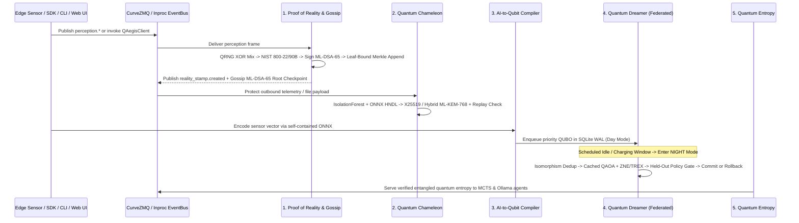

# System Architecture

Q-Aegis uses an event-driven asynchronous microkernel architecture engineered to decouple hard sub-10ms real-time edge operations from asynchronous post-quantum cross-witnessing, live Mission-Control telemetry, and multi-second Night-Mode quantum optimization.

---

## Core Microkernel, SDK & Mission Control

| Component | Module | Responsibility |
| :--- | :--- | :--- |
| **Python SDK Facade** | `qaegis.sdk` | High-level async context manager (`QAegisClient`) exposing 1-call stamping, detached file signing, hybrid encryption, tensor compilation, QAOA Max-Cut, and quantum randomness. |
| **Event Bus** | `qaegis.core.bus` | Strongly typed Pydantic v2 `EventEnvelope` pub/sub and request/reply with configurable backpressure (`block`, `drop_oldest`, `reject`), event-ID deduplication, and CurveZMQ (`AsyncioAuthenticator` Curve25519 ZAP allowlists). |
| **Configuration** | `qaegis.core.config` | Hierarchical YAML + `QAEGIS_*` environment variable configuration validated via `pydantic-settings` with cross-field invariants and hot-reload support. |
| **Device Identity & Keyring** | `qaegis.core.identity` | Generates, zero-downtime rotates (`TrustKeyring`), and zeroizes hybrid PQC (`ML-DSA-65`, `SLH-DSA-SHA2-128f`, `ML-KEM-768`) + `X25519` identities with native and CycloneDX 1.6 CBOM export. |
| **Hardware Sealing** | `qaegis.core.hardware_seal` | Pluggable `HardwareSealer` protocol wrapping private key bundles via PKCS#11 HSM / SoftHSM2 non-extractable AES-256 KEKs or Linux TPM 2.0 PCR-bound `/dev/tpmrm0` sealing. |
| **Lifecycle Manager** | `qaegis.core.lifecycle` | Explicit state machine (`DAY`, `TRANSITIONING_TO_NIGHT`, `NIGHT`, `TRANSITIONING_TO_DAY`, `SHUTDOWN`) driven by UTC schedules, host CPU idle thresholds (`psutil`), or live dashboard/CLI triggers. |
| **Persistent Store** | `qaegis.core.storage` | Async SQLite (`aiosqlite`) in WAL mode with schema v2 migrations, serialized atomic transactions, Merkle leaves, gossip checkpoints, row-hashed dream queues, policy snapshots, and SHA-256 hash-chained audit logs. |
| **Observability** | `qaegis.core.telemetry` | Stream-resilient `stderr` structured logging (`structlog`) and Prometheus `/metrics` exporter. |
| **Web Mission Control** | `qaegis.dashboard` | Async `h11` HTTP/1.1 + chunked Server-Sent Events (`/api/events/stream`) control plane serving an offline-capable 8-tab browser UI with live telemetry and hot YAML reconfiguration. |

---

## End-to-End Runtime Sequence

---

## Inter-Module Zero-Trust Guarantees

1. **Wire Envelope Integrity:** Every `EventEnvelope` computes and validates a canonical `payload_sha256` digest upon construction and deserialization (`EventEnvelope.from_wire_bytes`). Tampered envelopes are rejected before reaching any handler.
2. **Database Row & Chain Verification:** `StorageEngine` maintains a continuous SHA-256 hash chain across `audit_log` plus canonical SHA-256 row digests across `dream_problems` and `policy_snapshots`, verified continuously by `qaegis doctor` and the Web Mission-Control Dashboard.
3. **Hot Configuration Safety:** Live updates submitted via `DashboardKernelRuntime.update_config()` are validated against the full `QAegisConfig` Pydantic schema under an async lock, applied in memory across running services, written atomically (`0o600` `mkstemp` + `fsync` + `os.replace`), and recorded in the tamper-evident audit chain.
