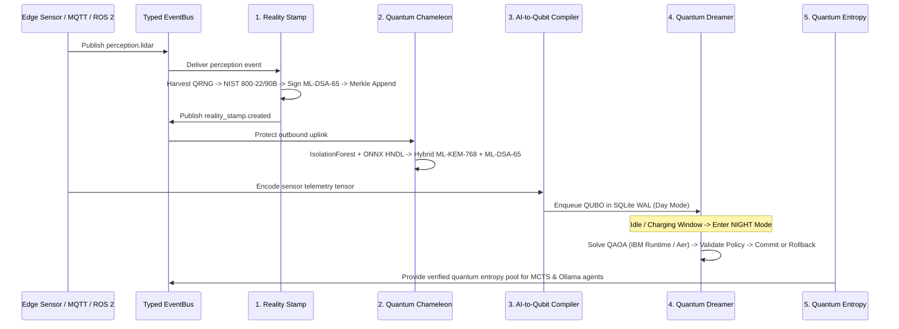

# System Architecture

Q-Aegis uses an event-driven microkernel architecture designed to decouple hard real-time edge workloads from asynchronous post-quantum auditing and multi-second quantum optimization.

## Core Microkernel (`qaegis.core`)

| Component | Module | Responsibility |
| :--- | :--- | :--- |
| **Event Bus** | `qaegis.core.bus` | Strongly typed Pydantic v2 `EventEnvelope` pub/sub and request/reply with configurable backpressure (`block`, `drop_oldest`, `reject`) and optional ZeroMQ (`zmq.asyncio`) transport. |
| **Configuration** | `qaegis.core.config` | Hierarchical YAML + `QAEGIS_*` environment variable configuration validated via `pydantic-settings`. |
| **Device Identity** | `qaegis.core.identity` | Generates, persists (`0o600` atomic writes), loads, and rotates hybrid PQC (`ML-DSA-65`, `SLH-DSA-SHA2-128f`, `ML-KEM-768`) + `X25519` node identities with CBOM export. |
| **Lifecycle Manager** | `qaegis.core.lifecycle` | Explicit state machine (`DAY`, `TRANSITIONING_TO_NIGHT`, `NIGHT`, `TRANSITIONING_TO_DAY`, `SHUTDOWN`) driven by UTC schedules, host CPU idle thresholds (`psutil`), or manual CLI/RPC triggers. |
| **Persistent Store** | `qaegis.core.storage` | Async SQLite (`aiosqlite`) in WAL mode with schema migrations, atomic transactions, Merkle leaf persistence, priority problem queue, versioned policy snapshots, and SHA-256 hash-chained audit logs. |
| **Observability** | `qaegis.core.telemetry` | Structured JSON logging (`structlog`) and Prometheus `/metrics` instrumentation. |

## End-to-End Data Flow

## Inter-Module Zero-Trust Validation

Every `EventEnvelope` computes and validates a canonical `payload_sha256` digest upon construction and wire deserialization (`EventEnvelope.from_wire_bytes`). Tampered payloads are rejected before reaching any subscriber handler.
